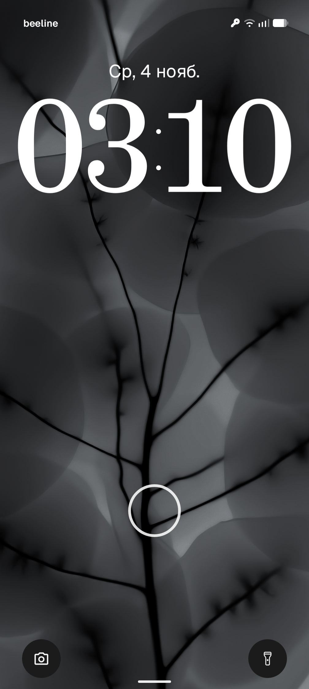
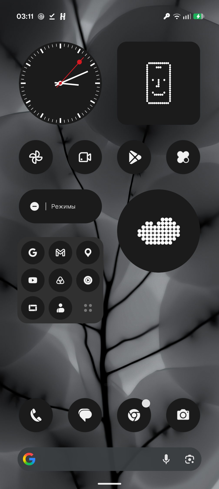
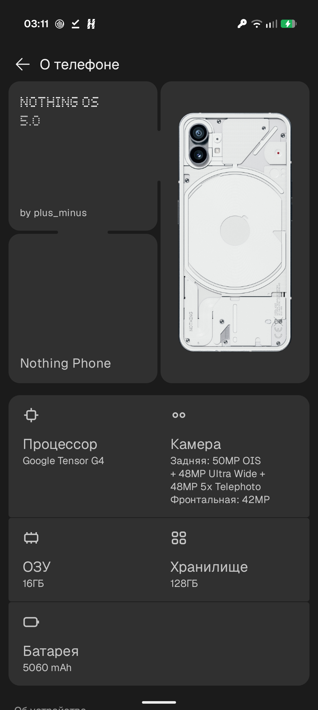

# NothingOS 5.0 for Pixel 9 Pro XL (komodo)

Port of **Nothing OS 5.0** (Nothing Phone 3, Android 17, build `C5.0-260924-2115`) to the **Google Pixel 9 Pro XL** (Tensor G4).
Runs on top of the stock Pixel vendor **BP1A.250505.005**. Port by **plus_minus**.

[Русский](#русский) · [English](#english)

## Screenshots

  

## Download

| File | Link |
|---|---|
| NothingOS5-komodo-v1.0.7z (3.6 GB) | [**Google Drive**](https://drive.google.com/file/d/1-L0qK9bJjvT9EegIDCUUqTeBY2yz1S65/view?usp=sharing) · [**Mega**](https://mega.nz/file/qG4XlCaD#-g8sPDxBx7RHIJtfmq7eVc5usaPbm2Gstl7iCzMQ1DY) |

SHA256 checksums of the images are in [SHA256SUMS](SHA256SUMS) (also inside the archive).

**Changelog:** [CHANGELOG.md](CHANGELOG.md)

**Discussion / Обсуждение:** [4PDA](https://4pda.to/forum/index.php?showtopic=1093998&st=1060#entry145831468) · [XDA thread](https://xdaforums.com/t/rom-port-komodo-nothingos-5-0-android-17-for-pixel-9-pro-xl.4807503/)

> This repository has only the flash scripts and instructions. The system images are distributed as an archive (links above).

---

## English

### What's inside
- Nothing OS 5.0 system, system_ext and product (EROFS), adapted to the Pixel vendor
- `vendor_boot.img`: stock BP1A.250505.005 with an fstab patched for the Nothing EROFS partitions
- `vbmeta.img`: stock, flashed with verity/verification disabled
- **Pixel Camera** built in, with all lenses, EdgeTPU and Pixel Camera Services. It is the default camera in the dock.
- Fixes:
  - Bluetooth headphone audio (the Qualcomm A2DP offload command in the Nothing BT stack is patched to the standard AOSP one that the Pixel controller accepts);
  - status bar height (apps' top buttons no longer sit under the status bar);
  - vibration on the stock HAL;
  - media server on 64-bit;
  - ringtones and sounds;
  - device info in Settings.

### Not working / known issues
- Nothing Camera is removed (it is incompatible with the Pixel camera HAL). Use Pixel Camera.
- Face unlock
- VoLTE/VoWiFi untested

### Install
See [INSTALL_EN.txt](INSTALL_EN.txt). In short:
1. Unlock the bootloader and flash the factory image **komodo BP1A.250505.005**.
2. Reboot to the bootloader and run `./flash-all.sh` (Linux/macOS) or `flash-all.bat` (Windows).
3. Wipe data when the script asks, then reboot.

Back to stock: flash the factory image with a wipe.

---

## Русский

### Что внутри
- system, system_ext и product из Nothing OS 5.0 (EROFS), адаптированные под вендор Pixel
- `vendor_boot.img`: сток BP1A.250505.005 с исправленным fstab под EROFS-разделы Nothing
- `vbmeta.img`: сток, прошивается с отключённой verity/verification
- **Pixel Camera** встроена, со всеми модулями, EdgeTPU и Pixel Camera Services. Стоит на месте камеры в доке.
- Исправлено:
  - звук в Bluetooth-наушниках (в стеке Bluetooth Nothing команда A2DP offload Qualcomm заменена стандартной AOSP, которую понимает контроллер Pixel);
  - высота статус-бара (верхние кнопки приложений больше не уходят под него);
  - вибрация через стоковый HAL;
  - 64-битный media server;
  - рингтоны и звуки;
  - информация об устройстве в настройках.

### Не работает / известные проблемы
- Камера Nothing убрана: она несовместима с HAL камеры Pixel. Используйте Pixel Camera.
- Разблокировка по лицу
- VoLTE/VoWiFi не проверены

### Установка
Подробно в [INSTALL_RU.txt](INSTALL_RU.txt). Коротко:
1. Разблокируйте загрузчик и прошейте заводской образ **komodo BP1A.250505.005**.
2. Зайдите в bootloader и запустите `./flash-all.sh` (Linux/macOS) или `flash-all.bat` (Windows).
3. Сделайте вайп, когда скрипт спросит, и перезагрузитесь.

Откат: прошить заводской образ с вайпом.

---

## Disclaimer
Nothing OS is the property of Nothing Technology Limited. Pixel Camera and the vendor components are the property of Google LLC.
This is an unofficial, non-commercial community port and is not affiliated with Nothing or Google. Flash at your own risk.
